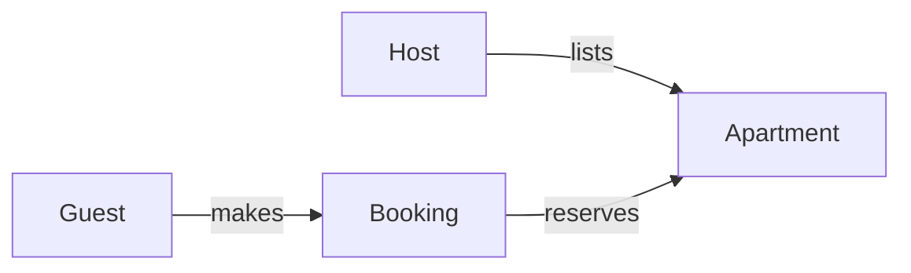

# 🏠 Apartment Booking API

> A headless REST API for apartment listing management, booking lifecycle operations, availability search, and deterministic overlap prevention.


**Course:** DevOps — Free University of Bozen-Bolzano
**Project:** Project 1 — Apartment Booking
**Deliverable:** Checkpoint 1 — Domain Modeling, Implementation & API Persistence

---

## 📑 Table of Contents

- [Overview](#-overview)
- [Domain Model](#-domain-model)
- [Roles & User Stories](#-roles--user-stories)
- [API Reference](#-api-reference)
- [Getting Started](#-getting-started)
- [Persistence](#-persistence)
- [Verification & Testing](#-verification--testing)
- [Tech Stack](#-tech-stack)

---

## 📖 Overview

This project provides a REST API that supports:

- ✅ Complete apartment listing management
- ✅ Booking lifecycle operations (create, list, reschedule, cancel)
- ✅ Date-range availability discovery
- ✅ Deterministic reservation overlap prevention
- ✅ Persistent storage that survives application restarts

---

## 🗺️ Domain Model



| Entity | Description |
|--------|-------------|
| **Host** | Lists apartments |
| **Apartment** | A unit available for booking |
| **Guest** | Makes bookings |
| **Booking** | A reservation of an apartment for a date range |

---

## 👥 Roles & User Stories

**🧑‍💼 Host**
Publishes, inspects, modifies, and de-lists apartment units.

**🧳 Guest**
Discovers available apartments across calendar ranges, and books or updates reservations.

> ⚠️ **System Invariant:** No two bookings may overlap on any active calendar dates for the same apartment unit.

---

## 🔌 API Reference

The API follows REST principles and is documented with OpenAPI/Swagger.

| Method | Endpoint | Description |
|--------|----------|-------------|
| `POST` | `/api/apartments` | Create a new apartment listing (name, address) |
| `GET` | `/api/apartments` | Retrieve all registered apartment listings |
| `GET` | `/api/apartments/search` | Filter available apartments for dates (`from`, `to`) |
| `POST` | `/api/bookings` | Reserve an apartment. Rejects overlapping dates (`400`) |
| `GET` | `/api/bookings` | List all existing reservations |
| `PUT` | `/api/bookings/{id}` | Reschedule booking dates, subject to non-collision validation |
| `DELETE` | `/api/bookings/{id}` | Cancel and remove an existing reservation |

### 📚 Interactive Documentation

Once the application is running, open Swagger UI:

👉 **http://localhost:8080/swagger-ui.html**

---

## 🚀 Getting Started

### Prerequisites

- Java 17
- Maven

### Clone the repository

```bash
git clone https://github.com/saif-elbach/DEVOPS-Project1-Apartment-Booking.git
cd DEVOPS-Project1-Apartment-Booking
```

### Build & package

```bash
mvn clean package
```

### Run the application

```bash
mvn spring-boot:run
```

The API will be available at `http://localhost:8080`.

---

## 💾 Persistence

Data is stored using **embedded H2 in file mode**, so it survives application restarts.

```
./data/bookingdb.mv.db
```

---

## ✅ Verification & Testing

The overlap collision invariant is tested and enforced through:

- Automated integration checks
- Custom repository JPQL queries

---

## 🛠️ Tech Stack

| Technology | Purpose |
|------------|---------|
| Java 17 | Language |
| Spring Boot 3 | Application framework |
| H2 Database | Embedded file-based persistence |
| Swagger / OpenAPI | API documentation |
| Maven | Build tool |

---

## 🔗 Links

- **Repository:** https://github.com/saif-elbach/DEVOPS-Project1-Apartment-Booking.git
- **Swagger UI:** http://localhost:8080/swagger-ui.html (when running locally)<img width="642" height="226" alt="Screenshot 2026-10-16 185649"
